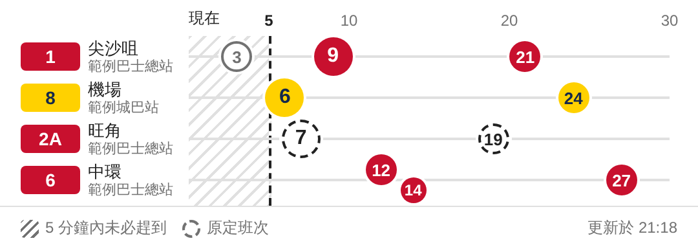

# buseta

[中文](#中文) | [English](#english)

## 中文

香港本地化的Home Assistant Repo！希望可以聚集更多本地使用者

這是一個Dashboard 的卡片，以時間軸顯示香港巴士預計到站時間，目前支援九巴（KMB）和城巴（Citybus），歡迎加入其他有用的營辦商資料。卡片會標示出門來不及的班次。

資料來自政府開放數據 API。

### 安裝

#### 方法一：HACS（建議）

1. 在 HACS 右上角選單選「Custom repositories」，Repository 填 `https://github.com/Huiyuen07/hkbuseta`，Type 選「Dashboard」。
2. 在 HACS 搜尋「Bus ETA」並下載，然後重新整理瀏覽器。(有待HACS審批)

HACS 會自動加入資源，版本更新也在 HACS 完成。如果資源是用 YAML 管理，要自行加入 `/hacsfiles/hkbuseta/buseta-card.js`。

#### 方法二：手動下載

1. 下載[最新版本](https://github.com/Huiyuen07/hkbuseta/releases/latest)，把 `dist/` 內的四個 `.js` 檔複製到 `/config/www/buseta/`。有 SSH 的話，可以改為在 repo 內執行 `./deploy.sh <ssh-host>`，指令最後會印出資源網址。
2. 加入資源：到「設定 → 儀表板 → 右上角選單 → 資源」新增 `/local/buseta/buseta-card.js`，類型選「JavaScript 模組」。

更新版本後，要在資源網址加上或更改 `?v=`（`deploy.sh` 會印出新值），瀏覽器才會載入新版。

### 新增卡片

在 Dashboard 新增卡片，搜尋「Bus ETA」，再用編輯視窗設定，不用查站點 ID。

喜歡寫 YAML 的話，按編輯視窗左下角的「使用文字編輯器」，內容見 `examples/lovelace-card.yaml`。兩者讀寫同一份設定。

### 設定（卡片 YAML）

| 欄位 | 說明 | 預設值 |
|------|------|--------|
| `title` | 卡片標題 | 無 |
| `refresh_seconds` | 更新間隔（秒），最少 `10` | `30` |
| `max_minutes` | 只顯示此分鐘數內到站的班次，也是時間軸的長度，最少 `1` | `30` |
| `leave_minutes` | 出門時間（分鐘），`0` 為關閉 | `5` |
| `color_scheme` | 配色：`auto`、`mono`、`led`、`icehouse` | `auto` |
| `grid_options` | HA 的卡片大小設定：`columns`（欄）和 `rows`（行） | 全寬、8 行 |
| `stops` | 要顯示的站點 | 必填 |
| `exclude` | 要隱藏的班次規則 | `[]` |

`stops` 每項的欄位：

| 欄位 | 說明 |
|------|------|
| `operator` | `kmb` 或 `ctb` |
| `stop_id` | 營運商的站點 ID。純數字的 ID 要加引號，例如 `"002403"` |
| `routes` | 要顯示的路線，城巴必填。九巴不寫時顯示該站所有路線 |

`routes` 每項可以只寫路線號，也可以寫成物件：

| 欄位 | 說明 |
|------|------|
| `route` | 路線號 |
| `dir` | `I` 或 `O`。不寫時顯示兩個方向 |
| `service_type` | 九巴專用：同一方向有多個目的地時，指定其中一個 |
| `label` | 編輯器顯示的方向文字，不影響卡片顯示的班次 |

站名一律即時取自營運商，不存於設定，九巴站名後的站牌代碼（例如 `(WT916)`）不會顯示。

### 重複班次

九巴會為同一班車的每個 `service_type` 各回傳一筆。同站、同路線、同方向而且 ETA 相同的班次只顯示一個圓點，並保留 `service_type` 最小的一筆。

`routes` 和 `exclude` 都先於去重執行。如果想顯示另一個目的地，用 `routes` 的 `service_type` 指定，或用 `exclude` 隱藏不要的一筆。

### 授權

[MIT](LICENSE)

---

## English

A Home Assistant repo localized for Hong Kong! We hope it brings more local users together.

This is a Dashboard card that shows Hong Kong bus arrivals on a time axis. It currently supports KMB and Citybus, and data for other useful operators is welcome. The card marks buses you may be too late for.

Data comes from the government's open data APIs.

### Install

#### Option 1: HACS (recommended)

1. In HACS, open the top-right menu and choose Custom repositories. Enter `https://github.com/Huiyuen07/hkbuseta` as the repository and choose Dashboard as the type.
2. Search for "Bus ETA" in HACS, download it, then refresh your browser. (Pending HACS approval)

HACS adds the resource for you and handles updates. If you manage resources in YAML, add `/hacsfiles/hkbuseta/buseta-card.js` yourself.

#### Option 2: Manual download

1. Download the [latest release](https://github.com/Huiyuen07/hkbuseta/releases/latest) and copy the four `.js` files in `dist/` to `/config/www/buseta/`. With SSH, you can instead run `./deploy.sh <ssh-host>` from the repo. The command ends by printing the resource URL.
2. Add the resource: go to Settings → Dashboards → top-right menu → Resources, add `/local/buseta/buseta-card.js`, and choose JavaScript module.

After an update, add or change `?v=` in the resource URL (`deploy.sh` prints the new value), so browsers load the new version.

### Add the card

Add a card to your dashboard, search for "Bus ETA", and set it up in the edit dialog. You don't need stop IDs.

To write YAML instead, select the text editor option at the bottom left of the dialog. See `examples/lovelace-card.yaml`. Both read and write the same config.

### Configuration (card YAML)

| Field | Meaning | Default |
|-------|---------|---------|
| `title` | Card title | None |
| `refresh_seconds` | Refresh interval in seconds, at least `10` | `30` |
| `max_minutes` | Only show buses arriving within this many minutes, at least `1`. Also the length of the time axis | `30` |
| `leave_minutes` | Leaving time in minutes. `0` turns it off | `5` |
| `color_scheme` | Color scheme: `auto`, `mono`, `led` or `icehouse` | `auto` |
| `grid_options` | HA's card size: `columns` and `rows` | Full width, 8 rows |
| `stops` | Stops to display | Required |
| `exclude` | Rules for buses to hide | `[]` |

Fields for each entry in `stops`:

| Field | Meaning |
|-------|---------|
| `operator` | `kmb` or `ctb` |
| `stop_id` | The operator's stop ID. Put all-digit IDs in quotes, such as `"002403"` |
| `routes` | Routes to show. Required for Citybus. Without it, a KMB stop shows every route |

Each entry in `routes` is a route number or an object:

| Field | Meaning |
|-------|---------|
| `route` | Route number |
| `dir` | `I` or `O`. Without it, both directions appear |
| `service_type` | KMB only: picks one destination when a direction has several |
| `label` | Direction text for the editor. It doesn't change which buses appear |

Stop names always come live from the operator and aren't stored in the config. The stop code after a KMB name, such as `(WT916)`, isn't shown.

### Duplicate departures

KMB returns a departure once for each `service_type`. Departures with the same stop, route, direction and ETA appear as one dot, keeping the lowest `service_type`.

`routes` and `exclude` both run before this step. To show the other destination, set `service_type` in `routes`, or hide the one you don't want with `exclude`.

### License

[MIT](LICENSE)
